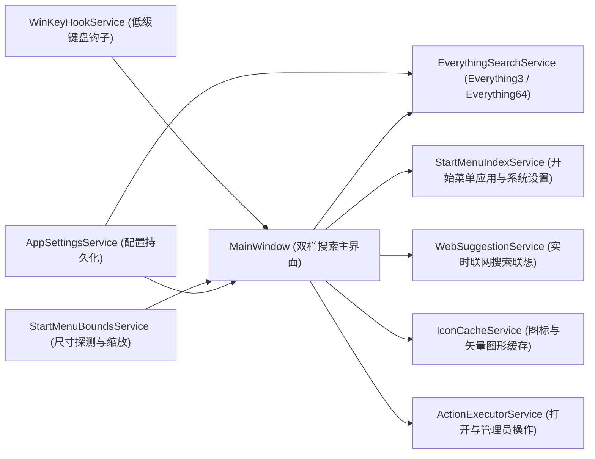

# EverythingonStart

复刻 Windows 11 原生开始菜单搜索双栏体验的极速聚合搜索启动器。底层本地文件检索直连 Everything（支持 Everything 1.5 `Everything3.dll` 命名管道与 Everything 1.4/1.5 `Everything64.dll` IPC），同时聚合开始菜单应用、Windows 11 系统设置与实时 Web 联网搜索建议。

---

## 核心特性

### 1. 双模式 Win 键触发与无缝输入接管
- **按 Win 键打开开始菜单后打字接管模式（默认）**：单按 `Win` 键正常弹出 Windows 11 原生开始菜单；一旦在开始菜单界面敲击字母或数字键，立即捕获首个按键、关闭原生开始菜单并弹出 `EverythingonStart` 搜索框继续输入。
- **单按 Win 键直接呼出搜索面板模式**：单独按下并释放 `Win` 键时直接弹出已预热的 `EverythingonStart` 搜索窗口并聚焦输入框，敲击键盘（含中文输入法首字母）立即检索。
- **完整保留系统组合键**：所有 `Win + 组合键`（如 `Win + E`、`Win + R`、`Win + D`、`Win + L`、`Win + V`、`Win + Shift + S`）均保持系统原生行为。

### 2. 开始菜单尺寸自动识别与多设备自适应缩放
- **动态探测原生开始菜单尺寸**：通过 [`StartMenuBoundsService`](file:///e:/EverythingonStart/Services/StartMenuBoundsService.cs) 自动探测当前显示器上 Windows 11 原生开始菜单窗口的实际卡片尺寸，并结合当前屏幕工作区高度、DPI 缩放比例计算窗口宽高与界面缩放比例（`ScaleTransform`）。
- **多显示器与任务栏布局适配**：自动识别任务栏位置（底部居中、底部靠左、顶部或侧边任务栏），精确停靠在开始菜单弹出位置。支持在设置中心切换自动缩放与手动缩放比例（`80%` - `135%`）。

### 3. 无任务栏图标与全屏窗口任务栏保留
- **任务栏零图标占用**：搜索窗口同时配置 `ShowInTaskbar = false`、移除 `WS_EX_APPWINDOW`、启用 `WS_EX_TOOLWINDOW` 扩展样式，并通过 `ITaskbarList2::DeleteTab` 确保运行与呼出期间不在任务栏产生图标。
- **全屏应用呼出时保留任务栏**：当用户在全屏游戏或全屏应用中按下 `Win` 键触发搜索时，自动通过 `ITaskbarList2::MarkFullscreenWindow` 与窗口 Z 序调整唤醒底部任务栏，保持与原生开始菜单一致的视觉层级。

### 4. 多数据源毫秒级聚合与流畅交互动画
- **本地文件与文件夹**：通过 [`EverythingSearchService`](file:///e:/EverythingonStart/Services/EverythingSearchService.cs) 直连 Everything 实时索引，毫秒级返回最佳匹配、应用、文档、文件夹与照片结果。
- **开始菜单应用与系统设置**：[`StartMenuIndexService`](file:///e:/EverythingonStart/Services/StartMenuIndexService.cs) 内存常驻索引系统与用户开始菜单快捷方式及 30+ 项常用 Windows 11 `ms-settings:` 系统设置（统一采用 `mingcute:settings-4-line` 矢量设置图标）。
- **实时 Web 联网搜索建议**：[`WebSuggestionService`](file:///e:/EverythingonStart/Services/WebSuggestionService.cs) 异步获取搜索联想词，支持一键通过 Bing、Google、百度或 DuckDuckGo 在默认浏览器中打开搜索结果。
- **高性能阴影隔离与微浮动动画**：窗口阴影独立为启用 `<BitmapCache />` 的兄弟背景层，搜索列表与操作按钮具备平滑的鼠标悬停高亮及微浮动位移动画，结合 14ms 输入防抖与单键元组排序，确保高频输入与滚动零卡顿。

### 5. 排序方式、附加类型筛选与三种文件类型配置模式
- **多维排序方式**：主界面顶部工具栏与右侧三点菜单支持实时切换：
  - 智能相关度排序（默认）
  - 跟随 Everything 当前排序设置（自动读取 `Everything.ini`）
  - 名称、路径、文件大小、修改时间、创建时间、扩展名（升序 / 降序）
- **附加类型筛选器**：支持在任意分类下叠加筛选「仅音频文件」「仅视频文件」「仅压缩包文件」「仅代码源文件」「仅可执行程序」「仅文件夹」「仅文件」。
- **三种分类文件类型模式**：`应用`、`文档`、`文件夹`、`照片` 等分类子选项支持全局统一或按分类独立设置以下三种模式：
  1. **默认模式**：使用内置文件扩展名与检索规则（如“文档”分类默认匹配所有非文件夹文件，或仅匹配常见文档扩展名）。
  2. **跟随 Everything 设置模式**：自动解析本地 Everything 的 `Filters.csv`（1.4 / 1.5 实例筛选器）与 `Everything.ini` 配置。
  3. **自定义模式**：自由编辑各分类的扩展名列表（分号分隔）或完整 Everything 搜索语法（如 `ext:pdf;docx !path:temp`）。

### 6. 初始搜索分类记忆与导航体验
- **打开主界面后搜索项配置**：支持在设置中心、主界面三点菜单或托盘菜单中配置每次呼出主界面时的初始分类：
  - **默认“全部”**：每次打开搜索窗口时自动回到“全部”分类。
  - **上次退出时最后搜索项**：自动记忆并恢复上次关闭窗口或退出程序前选中的分类标签（持久化保存在配置文件中）。
- **左上角返回/关闭按钮**：处于子分类页面（如“应用”“文档”“照片”）时点击左上角返回键退回“全部”页面；处于“全部”页面时点击直接关闭搜索窗口。

---

## 系统架构



### 核心源码目录

| 文件路径 | 功能职责 |
| --- | --- |
| [`App.xaml.cs`](file:///e:/EverythingonStart/App.xaml.cs) | 单实例互斥锁、系统托盘菜单、命令行参数处理（`--replace`、`--self-test`）与核心服务生命周期管理 |
| [`MainWindow.xaml`](file:///e:/EverythingonStart/MainWindow.xaml) / [`MainWindow.xaml.cs`](file:///e:/EverythingonStart/MainWindow.xaml.cs) | 双栏搜索主界面、分类胶囊切换、排序与扩展筛选下拉框、详情面板及悬停浮动动画 |
| [`SettingsWindow.xaml`](file:///e:/EverythingonStart/SettingsWindow.xaml) / [`SettingsWindow.xaml.cs`](file:///e:/EverythingonStart/SettingsWindow.xaml.cs) | 四分页设置中心窗口（分类与文件类型、排序与搜索规则、交互与呼出行为、外观缩放与系统） |
| [`Models/SearchModels.cs`](file:///e:/EverythingonStart/Models/SearchModels.cs) | 搜索分类、排序枚举、筛选模式、初始搜索项模式与列表条目数据模型 |
| [`Services/AppSettingsService.cs`](file:///e:/EverythingonStart/Services/AppSettingsService.cs) | `%LOCALAPPDATA%\EverythingonStart\settings.json` 配置读写与开机自启注册表管理 |
| [`Services/EverythingSearchService.cs`](file:///e:/EverythingonStart/Services/EverythingSearchService.cs) | `Everything3.dll` 与 `Everything64.dll` 双引擎检索封装、`Filters.csv` 与 `Everything.ini` 解析 |
| [`Services/StartMenuBoundsService.cs`](file:///e:/EverythingonStart/Services/StartMenuBoundsService.cs) | 原生开始菜单窗口探测、跨分辨率自适应尺寸与缩放系数计算 |
| [`Services/WinKeyHookService.cs`](file:///e:/EverythingonStart/Services/WinKeyHookService.cs) | `WH_KEYBOARD_LL` 键盘钩子、单按 `Win` 键识别与原生开始菜单打字拦截 |
| [`Services/StartMenuIndexService.cs`](file:///e:/EverythingonStart/Services/StartMenuIndexService.cs) | 开始菜单程序索引与 Windows 11 `ms-settings:` 系统设置条目匹配 |
| [`Services/IconCacheService.cs`](file:///e:/EverythingonStart/Services/IconCacheService.cs) | 文件系统图标缓存与 `mingcute:settings-4-line` 矢量设置图标渲染 |
| [`Services/ActionExecutorService.cs`](file:///e:/EverythingonStart/Services/ActionExecutorService.cs) | 文件打开、管理员运行、文件所有权获取、定位文件位置与跳转 Everything 窗口 |

---

## 设置中心说明

### 主题与系统配色

在「外观与系统 → 主题与配色」中，可以选择 **跟随系统 / 浅色 / 深色**，并独立勾选 **使用系统强调色**。
点击「保存并应用」后同时更新主搜索界面、设置中心及应用菜单，无需重启。
选择跟随系统后，Windows 应用主题或强调色发生变化时会自动同步。
强调色文字会调整明暗以保持可读性；文件与应用的原始图标保持不变。
未勾选系统强调色时使用蓝色；旧配置与默认设置仍保持深色及蓝色，避免升级改变已有外观。

点击主界面右下角「打开设置中心」、右上角 `...` 菜单或系统托盘菜单即可打开设置中心，包含 4 个配置页面：

1. **分类与文件类型**
   - 配置「打开主界面后搜索项」（默认“全部” / 上次退出时最后搜索项）。
   - 切换分类筛选模式（默认内置 / 跟随 Everything 设置 / 自定义），支持按 `应用`、`文档`、`文件夹`、`照片` 单独指定模式。
   - 自定义各分类及附加筛选（音频、视频、压缩包、代码文件）的扩展名或 Everything 搜索表达式，支持一键恢复默认与重新读取 Everything 配置。
2. **排序与搜索规则**
   - 配置默认排序方式、Everything 搜索匹配修饰符（区分大小写、全字匹配、匹配完整路径、启用正则表达式，或跟随 `Everything.ini`）。
   - 配置「全部」页面每组最大显示条数、单分类最大显示条数及各数据源启用开关。
3. **交互与呼出行为**
   - 配置 `Win` 键触发方式、打开主界面后默认搜索分类、左上角返回键在「全部」页关闭窗口、全屏窗口下呼出时保留任务栏、`Esc` 键优先清空输入、失去焦点自动隐藏及默认联网搜索引擎。
4. **外观缩放与系统**
   - 配置自动识别开始菜单大小并缩放适配、手动缩放比例、窗口背景不透明度、弹出动画、开机自动启动，以及自定义 Everything 主程序、`Filters.csv` 和 `Everything.ini` 路径。

配置文件默认保存在：
```text
%LOCALAPPDATA%\EverythingonStart\settings.json
```

---

## 快捷键说明

| 快捷键 | 功能 |
| --- | --- |
| `Win` | 呼出或隐藏搜索面板（或打开原生开始菜单后直接打字接管） |
| `↑` / `↓` | 上下移动选中结果（自动跳过分组标题） |
| `Tab` / `Shift + Tab` | 循环切换顶部分类胶囊标签（全部 / 应用 / 文档 / Web / 设置 / 文件夹 / 照片） |
| `Enter` | 打开选中文件、应用、系统设置或 Web 搜索 |
| `Ctrl + Enter` | 打开选中文件所在位置并在资源管理器中高亮选中 |
| `Ctrl + Shift + Enter` | 以管理员身份运行程序，或对普通文件执行管理员取得所有权 |
| `Ctrl + Shift + C` | 复制选中条目的完整路径到剪贴板 |
| `Esc` | 清空搜索框内容；若搜索框已为空则隐藏搜索窗口 |

---

## 编译与运行

### 环境要求
- Windows 10 / Windows 11 (x64)
- .NET 10.0 SDK (`net10.0-windows`)
- Everything 1.4 或 Everything 1.5（已在后台运行）

### 编译命令
```powershell
dotnet build EverythingonStart.csproj -c Release -p:Platform=x64
```

### 运行与命令行参数
```powershell
# 启动常驻进程（若已在运行则唤醒搜索面板）
.\bin\x64\Release\net10.0-windows\EverythingonStart.exe

# 替换正在运行的旧实例并重新启动
.\bin\x64\Release\net10.0-windows\EverythingonStart.exe --replace

# 运行内置自动化自检并输出诊断报告
.\bin\x64\Release\net10.0-windows\EverythingonStart.exe --self-test
```
