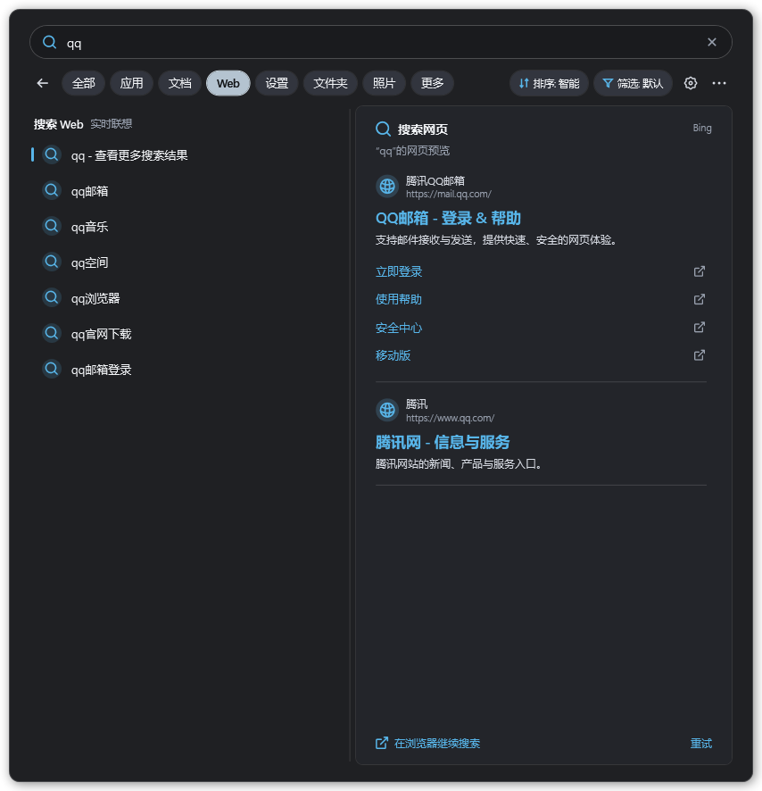
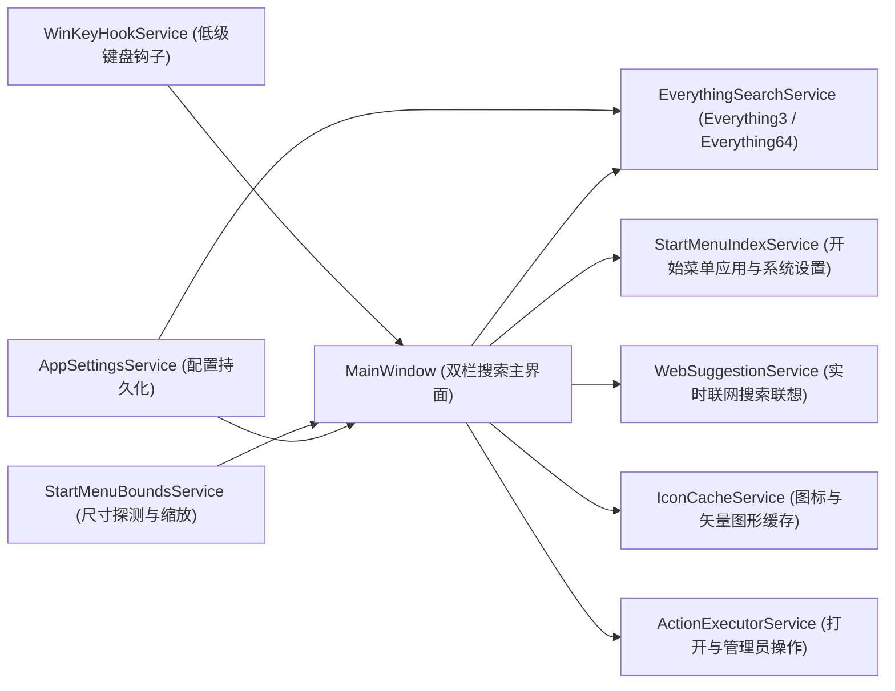

# EverythingonStart


复刻 Windows 11 原生开始菜单搜索双栏体验的极速聚合搜索启动器。底层本地文件检索直连 Everything（支持 Everything 1.5 `Everything3.dll` 命名管道与 Everything 1.4/1.5 `Everything64.dll` IPC），同时聚合开始菜单应用、Windows 11 系统设置与实时 Web 联网搜索建议。

## 下载与快速开始

从 [v1.5.0 Release](https://github.com/Hurt-In-Dream/EverythingonStart/releases/tag/v1.5.0) 选择 Windows x64 版本：

| 版本 | 下载 | 使用方式 |
| --- | --- | --- |
| 安装版 | [Setup-x64.exe](https://github.com/Hurt-In-Dream/EverythingonStart/releases/download/v1.5.0/EverythingonStart-v1.5.0-Setup-x64.exe) | 按用户安装，无需管理员权限，默认安装到 `%LOCALAPPDATA%\Programs\EverythingonStart` |
| 绿色单文件版 | [Portable-x64.exe](https://github.com/Hurt-In-Dream/EverythingonStart/releases/download/v1.5.0/EverythingonStart-v1.5.0-Portable-x64.exe) | 下载一个 EXE 即可运行，无需旁置 DLL 或安装 .NET |

单文件版内置 .NET 与 Everything SDK，首次运行会将原生运行库解压到 .NET 的用户临时缓存；设置仍保存在用户目录，不是零磁盘写入模式。
推荐 Windows 11 x64。文件检索需要安装并在后台运行 [Everything](https://www.voidtools.com/downloads/)。
首次启动后，按 `Win` 打开原生开始菜单并直接输入，或从系统托盘打开设置，切换为单按 `Win` 直接呼出。

更新前请先从托盘退出旧实例，再安装或运行新版。设置保存在 `%LOCALAPPDATA%\EverythingonStart\settings.json`，卸载保留设置；安装器不自动更改开机启动项。
发行包尚未进行代码签名；可使用同一 Release 的 `SHA256SUMS.txt` 校验下载文件。

### v1.5.0 拼音与首字母搜索

- 应用、系统设置、本地文件与文件夹新增全拼、拼音前缀与首字母搜索，如 `jisuanqi` / `jsq`、`renwulan` / `rwl`、`xiangmuwendang` / `xmwd`。
- 内置离线词典，支持常见多音字、简繁体、中文/数字混合名称与 `v` 代替 `ü`，无需 Everything 拼音插件。
- 保留原文字匹配和 Everything 高级语法；明确大小写、全字及正则匹配规则时不自动展开文件拼音查询。
- 包含 v1.4.2 的开始菜单输入干扰修复；更新前请从托盘退出旧实例。

### v1.4.2 输入干扰修复（已包含）

- 默认打字接管模式不再仅凭单按 Win 后的 850ms 宽限期截获输入；只有确认前台是原生开始菜单宿主后，才启动输入接管和关闭开始菜单。
- 开始菜单未打开、前台仍是游戏/普通应用或无法确定前台窗口时，放行输入，不因此合成 Esc；保留正常开始菜单接管、连续输入缓冲和 Win 组合键行为。
- 本次修复不等于通过腾讯 ACE 兼容性认证，也未确认解决三角洲行动启动失败。遇到游戏安全组件报错，请先从托盘完全退出本程序，再从官方启动器排查；切换现有两个触发模式不会卸载全局键盘钩子。

---

## 界面预览

主搜索界面与 Web 结果卡片：



浅色设置中心、主题与原生背景模糊选项：


菜单图标栏、勾选与分隔线使用统一主题底板（以下为测试数据示例）：


截图来自新版真实 WPF 界面，使用隔离配置与示例搜索结果，不含用户文件列表。此处展示 UI，不用静态截图证明动态壁纸效果。

## 核心特性

### 1. 双模式 Win 键触发与无缝输入接管
- **按 Win 键打开开始菜单后打字接管模式（默认）**：单按 `Win` 键正常弹出 Windows 11 原生开始菜单；一旦在开始菜单界面敲击字母或数字键，立即捕获首个按键、关闭原生开始菜单并弹出 `EverythingonStart` 搜索框继续输入。
- **单按 Win 键直接呼出搜索面板模式**：单独按下并释放 `Win` 键时直接弹出已预热的 `EverythingonStart` 搜索窗口并聚焦输入框，敲击键盘（含中文输入法首字母）立即检索。
- **完整保留系统组合键**：所有 `Win + 组合键`（如 `Win + E`、`Win + R`、`Win + D`、`Win + L`、`Win + V`、`Win + Shift + S`）均保持系统原生行为。

### 2. 开始菜单尺寸自动识别与多设备自适应缩放
- **动态探测原生开始菜单尺寸**：通过 [`StartMenuBoundsService`](Services/StartMenuBoundsService.cs) 自动探测当前显示器上 Windows 11 原生开始菜单窗口的实际卡片尺寸，并结合当前屏幕工作区高度、DPI 缩放比例计算窗口宽高与界面缩放比例（`ScaleTransform`）。
- **多显示器与任务栏布局适配**：自动识别任务栏位置（底部居中、底部靠左、顶部或侧边任务栏），精确停靠在开始菜单弹出位置。支持在设置中心切换自动缩放与手动缩放比例（`80%` - `135%`）。

### 3. 无任务栏图标与全屏窗口任务栏保留
- **任务栏零图标占用**：搜索窗口配置 `ShowInTaskbar = false`、移除 `WS_EX_APPWINDOW` 与 `WS_EX_TOOLWINDOW`，并通过隐藏 Owner 窗口和 `ITaskbarList2::DeleteTab` 确保运行与呼出期间不在任务栏产生图标。
- **全屏应用呼出时保留任务栏**：当用户在全屏游戏或全屏应用中按下 `Win` 键触发搜索时，自动通过 `ITaskbarList2::MarkFullscreenWindow` 与窗口 Z 序调整唤醒底部任务栏，保持与原生开始菜单一致的视觉层级。
- **不覆盖切换后的窗口**：收起搜索面板时保留窗口层级，避免此前任务栏定位重新置顶全屏窗口、导致 Alt+Tab 选中的窗口被遮挡。

### 4. 多数据源毫秒级聚合与流畅交互动画
- **本地文件与文件夹**：通过 [`EverythingSearchService`](Services/EverythingSearchService.cs) 直连 Everything 实时索引，毫秒级返回最佳匹配、应用、文档、文件夹与照片结果。
- **开始菜单应用与系统设置**：[`StartMenuIndexService`](Services/StartMenuIndexService.cs) 内存常驻索引系统与用户开始菜单快捷方式及 30+ 项常用 Windows 11 `ms-settings:` 系统设置（统一采用 `mingcute:settings-4-line` 矢量设置图标）。
- **拼音与首字母搜索**：应用、系统设置、本地文件与文件夹支持全拼、拼音前缀及首字母，例如 `jisuanqi` / `jsq` → 计算器、`renwulan` / `rwl` → 任务栏设置、`xiangmuwendang` / `xmwd` → 项目文档。支持常见多音字、简繁体及中文/数字混合名称；`ü` 可输入 `v`。词典随程序内置，无需联网或 Everything 拼音插件。
- **实时 Web 联网搜索建议**：[`WebSuggestionService`](Services/WebSuggestionService.cs) 异步获取搜索联想词，支持一键通过 Bing、Google、百度或 DuckDuckGo 在默认浏览器中打开搜索结果。
- **Web 右栏网页预览**：选中 Web 搜索词或建议后，右侧展示搜索引擎返回的网站、可点击标题、URL、摘要及可用的站内链接。保留完整搜索页入口；不再把 Web 项显示成文件属性卡片。
- **MingCute Web 图标**：搜索项、网站卡片及外部链接采用 MingCute 矢量图标，跟随主题强调色，文件与应用的原始图标不变。
- **高性能阴影隔离与微浮动动画**：窗口阴影独立为启用 `<BitmapCache />` 的兄弟背景层，搜索列表与操作按钮具备平滑的鼠标悬停高亮及微浮动位移动画，结合 14ms 输入防抖与单键元组排序，确保高频输入与滚动零卡顿。

### 5. 排序方式、附加类型筛选与三种文件类型配置模式
- **多维排序方式**：主界面顶部工具栏与右侧三点菜单支持实时切换：
  - 智能相关度排序（默认）
  - 跟随 Everything 当前排序设置（自动读取 `Everything.ini`）
  - 名称、路径、文件大小、修改时间、创建时间、扩展名（升序 / 降序）
- **附加类型筛选器**：支持在任意分类下叠加筛选「仅音频文件」「仅视频文件」「仅压缩包文件」「仅代码源文件」「仅可执行程序」「仅文件夹」「仅文件」。
- **三种分类文件类型模式**：`应用`、`文档`、`文件夹`、`照片` 等分类子选项支持全局统一或按分类独立设置以下三种模式：
  1. **默认模式**：使用内置文件扩展名与检索规则（如“文档”分类默认匹配所有非文件夹文件，或仅匹配常见文档扩展名）。
  2. **跟随 Everything 设置模式**：自动解析本地 Everything 的 `Filters.csv`（1.4 / 1.5 实例筛选器）与 `Everything.ini` 配置。
  3. **自定义模式**：自由编辑各分类的扩展名列表（分号分隔）或完整 Everything 搜索语法（如 `ext:pdf;docx !path:temp`）。

### 6. 初始搜索分类记忆与导航体验
- **打开主界面后搜索项配置**：支持在设置中心、主界面三点菜单或托盘菜单中配置每次呼出主界面时的初始分类：
  - **默认“全部”**：每次打开搜索窗口时自动回到“全部”分类。
  - **上次退出时最后搜索项**：自动记忆并恢复上次关闭窗口或退出程序前选中的分类标签（持久化保存在配置文件中）。
- **左上角返回/关闭按钮**：处于子分类页面（如“应用”“文档”“照片”）时点击左上角返回键退回“全部”页面；处于“全部”页面时点击直接关闭搜索窗口。

---

## 系统架构



### 核心源码目录

| 文件路径 | 功能职责 |
| --- | --- |
| [`App.xaml.cs`](App.xaml.cs) | 单实例互斥锁、系统托盘菜单、命令行诊断与核心服务生命周期管理 |
| [`MainWindow.xaml`](MainWindow.xaml) / [`MainWindow.xaml.cs`](MainWindow.xaml.cs) | 双栏搜索主界面、分类胶囊切换、排序与扩展筛选下拉框、详情面板及悬停浮动动画 |
| [`SettingsWindow.xaml`](SettingsWindow.xaml) / [`SettingsWindow.xaml.cs`](SettingsWindow.xaml.cs) | 四分页设置中心窗口（分类与文件类型、排序与搜索规则、交互与呼出行为、外观缩放与系统） |
| [`Models/SearchModels.cs`](Models/SearchModels.cs) | 搜索分类、排序枚举、筛选模式、初始搜索项模式与列表条目数据模型 |
| [`Services/AppSettingsService.cs`](Services/AppSettingsService.cs) | `%LOCALAPPDATA%\EverythingonStart\settings.json` 配置读写与开机自启注册表管理 |
| [`Services/EverythingSearchService.cs`](Services/EverythingSearchService.cs) | `Everything3.dll` 与 `Everything64.dll` 双引擎检索封装、`Filters.csv` 与 `Everything.ini` 解析 |
| [`Services/StartMenuBoundsService.cs`](Services/StartMenuBoundsService.cs) | 原生开始菜单窗口探测、跨分辨率自适应尺寸与缩放系数计算 |
| [`Services/WinKeyHookService.cs`](Services/WinKeyHookService.cs) | `WH_KEYBOARD_LL` 键盘钩子、单按 `Win` 键识别与原生开始菜单打字拦截 |
| [`Services/StartMenuIndexService.cs`](Services/StartMenuIndexService.cs) | 开始菜单程序索引与 Windows 11 `ms-settings:` 系统设置条目匹配 |
| [`Services/IconCacheService.cs`](Services/IconCacheService.cs) | 文件系统图标缓存与 `mingcute:settings-4-line` 矢量设置图标渲染 |
| [`Services/ActionExecutorService.cs`](Services/ActionExecutorService.cs) | 文件打开、管理员运行、文件所有权获取、定位文件位置与跳转 Everything 窗口 |
| [`Services/AppThemeService.cs`](Services/AppThemeService.cs) / [`Themes/ThemeResources.xaml`](Themes/ThemeResources.xaml) | 可选系统/浅色/深色主题、系统强调色与动态界面资源 |
| [`Services/WindowBackdropService.cs`](Services/WindowBackdropService.cs) | 当前窗口的原生 DWM/Accent 背景合成、圆角裁剪、高对比度回退 |
| [`Services/AppIconService.cs`](Services/AppIconService.cs) | 主窗口、设置中心、托盘的透明图标资源 |

---

## 设置中心说明

### 拼音搜索规则

普通输入自动同时匹配原文字和拼音；应用与设置的原文字标题匹配优先于拼音匹配。
文件检索将拼音转换为 Everything 原生正则字符集，分类、附加类型筛选与现有排序仍由 Everything 执行，不在每次输入时遍历或建立另一份全盘文件索引。

- 推荐连续输入不带声调的全拼或首字母；空格分隔的词保持 AND 匹配。
- 文件搜索中的引号、通配符、路径、`ext:` 等高级语法保持原样，不自动拼音展开。
- 开启「区分大小写」「全字匹配」「正则表达式」（包括跟随 Everything 配置）时，文件搜索保留这些规则，不做拼音扩展。应用/设置仍使用自身匹配规则。
- 文件查询自动展开限制为 48 个字符和 24,000 个正则/查询字符，歧义分词最多 32 条路径；过长或超限输入回退为原生文字查询。内置匹配覆盖 BMP 中日韩汉字，不承诺词义级多音字消歧或生僻扩展区汉字。

### 主题与系统配色

在「外观与系统 → 主题与配色」中，可以选择 **跟随系统 / 浅色 / 深色**，并独立勾选 **使用系统强调色**。
点击「保存并应用」后同时更新主搜索界面、设置中心及应用菜单，无需重启。
选择跟随系统后，Windows 应用主题或强调色发生变化时会自动同步。
强调色文字会调整明暗以保持可读性；文件与应用的原始图标保持不变。
未勾选系统强调色时使用蓝色；旧配置与默认设置仍保持深色及蓝色，避免升级改变已有外观。

### 原生背景模糊与 Wallpaper Engine

在「外观与系统 → 背景模糊（原生 DWM）」中启用，点击「保存并应用」生效；默认关闭，升级不强制改变已有配置。
参考 [DWMBlurGlass](https://github.com/Maplespe/DWMBlurGlass) 的 Accent / DWMAPI 路径，仅对本程序两个窗口启用 **Accent Acrylic**，不可用时尝试 Windows 11 **SystemBackdrop**，不使用其全局注入和私有 DWM 钩子。

- **实时合成**：DWM 使用当前窗口后方的实际合成内容，Wallpaper Engine 等第三方动态壁纸直接参与；不读取系统静态旧壁纸或项目 GIF/图片预览，不会缓存一张与实际壁纸不符的底图。
- **不是“仅壁纸”滤镜**：后方若有其他窗口，系统可能将其一起合成；不截屏、不保存背景帧，也不会保留开始菜单收起后的旧截图。
- **前景清晰**：文字、图标与交互控件不应用 WPF BlurEffect。原生模糊裁剪到卡片圆角，避免透明阴影边距出现矩形模糊。
- **强度由系统管理**：模糊半径不能通过公开的系统接口自定义，旧 `GaussianBlurRadius` 字段仅保留配置兼容性。背景不透明度可调染色强度，100% 时背景被遮住。
- **回退**：高对比度或系统接口不可用时使用原有主题背景；不会退回截图、壁纸文件或本地预览。

推荐 Windows 11 22H2 及以上，并开启 Windows「透明效果」。原生效果仍受 Windows 版本、显卡驱动及系统策略影响。
如 Wallpaper Engine 配置了「其他窗口最大化/全屏时暂停」或遮挡时暂停，壁纸动画会按其自身策略停止；请在 Wallpaper Engine 性能设置中按需选择继续播放。本程序不会改写第三方配置或强行唤醒壁纸进程。
测试已验证原生合成对合成背景实时变化的响应，以及主窗口/设置窗口、主题、Win 输入和全屏切换回归；不声称覆盖所有第三方壁纸软件、显示器和驱动组合。

点击主界面右下角「打开设置中心」、右上角 `...` 菜单或系统托盘菜单即可打开设置中心，包含 4 个配置页面：

1. **分类与文件类型**
   - 配置「打开主界面后搜索项」（默认“全部” / 上次退出时最后搜索项）。
   - 切换分类筛选模式（默认内置 / 跟随 Everything 设置 / 自定义），支持按 `应用`、`文档`、`文件夹`、`照片` 单独指定模式。
   - 自定义各分类及附加筛选（音频、视频、压缩包、代码文件）的扩展名或 Everything 搜索表达式，支持一键恢复默认与重新读取 Everything 配置。
2. **排序与搜索规则**
   - 配置默认排序方式、Everything 搜索匹配修饰符（区分大小写、全字匹配、匹配完整路径、启用正则表达式，或跟随 `Everything.ini`）。
   - 配置「全部」页面每组最大显示条数、单分类最大显示条数及各数据源启用开关。
3. **交互与呼出行为**
   - 配置 `Win` 键触发方式、打开主界面后默认搜索分类、左上角返回键在「全部」页关闭窗口、全屏窗口下呼出时保留任务栏、`Esc` 键优先清空输入、失去焦点自动隐藏及默认联网搜索引擎。
4. **外观缩放与系统**
   - 配置自动识别开始菜单大小并缩放适配、手动缩放比例、窗口背景不透明度、弹出动画、开机自动启动，以及自定义 Everything 主程序、`Filters.csv` 和 `Everything.ini` 路径。

配置文件默认保存在：
```text
%LOCALAPPDATA%\EverythingonStart\settings.json
```

---

## 快捷键说明

### Web 网页预览说明

右栏预览是**搜索结果卡片**，不是内嵌完整浏览器；选中不同联想词时跟随当前搜索引擎更新。
仅在窗口可见且选中 Web 项时请求搜索结果页，短暂延迟后请求以减少快速移动选择产生的网络访问。
切换选中项或隐藏窗口会取消旧请求，旧结果不会覆盖新词；成功结果在内存短期缓存，不写入磁盘。
不执行网页脚本，不读取浏览器登录信息，也不自动访问结果网站或下载网站图标。
搜索引擎可能要求验证码、限流或改变 HTML 布局，此时会明确提示并保留「在浏览器继续搜索」和「重试」，不会伪造预览结果。
点击标题或站内链接才在默认浏览器打开相应 HTTP/HTTPS 网站。

| 快捷键 | 功能 |
| --- | --- |
| `Win` | 呼出或隐藏搜索面板（或打开原生开始菜单后直接打字接管） |
| `↑` / `↓` | 上下移动选中结果（自动跳过分组标题） |
| `Tab` / `Shift + Tab` | 循环切换顶部分类胶囊标签（全部 / 应用 / 文档 / Web / 设置 / 文件夹 / 照片） |
| `Enter` | 打开选中文件、应用、系统设置或 Web 搜索 |
| `Ctrl + Enter` | 打开选中文件所在位置并在资源管理器中高亮选中 |
| `Ctrl + Shift + Enter` | 以管理员身份运行程序，或对普通文件执行管理员取得所有权 |
| `Ctrl + Shift + C` | 复制选中条目的完整路径到剪贴板 |
| `Esc` | 清空搜索框内容；若搜索框已为空则隐藏搜索窗口 |

---

## 编译与运行

### 环境要求
- Windows 10 / Windows 11 (x64)
- .NET 10.0 SDK (`net10.0-windows`)
- Everything 1.4 或 Everything 1.5（已在后台运行）

### 编译命令
```powershell
dotnet build EverythingonStart.csproj -c Release -p:Platform=x64
```

### 构建发行包

从已提交且工作区干净的源码构建安装版、绿色单文件版、对应源码包与 SHA256 校验文件。需要可信的 Inno Setup 6/7 编译器：

```powershell
pwsh -NoProfile -File .\Scripts\Publish-Release.ps1 -InnoSetupCompiler 'C:\Program Files (x86)\Inno Setup 6\ISCC.exe'
```

产物默认位于 `artifacts/`。打包脚本仅为本次构建指定官方 NuGet 源，不修改全局配置；
如需镜像，可使用 `-NuGetSource URL` 指定。详细回归测试命令见 [Tests/README.md](Tests/README.md)。

### 运行与命令行参数
```powershell
# 启动常驻进程（若已在运行则唤醒搜索面板）
.\bin\x64\Release\net10.0-windows\EverythingonStart.exe

# 替换正在运行的旧实例并重新启动
.\bin\x64\Release\net10.0-windows\EverythingonStart.exe --replace

# 运行内置自动化自检并输出诊断报告
.\bin\x64\Release\net10.0-windows\EverythingonStart.exe --self-test

# 单文件包诊断：不启动托盘、全局热键、设置服务或单实例接管
.\EverythingonStart-v1.5.0-Portable-x64.exe --package-self-test

# 输出单文件内嵌许可证
.\EverythingonStart-v1.5.0-Portable-x64.exe --licenses
```

## 许可证与第三方组件

Copyright (C) 2026 Hurt-In-Dream and contributors.

本项目原创源码按 **GNU GPL v3.0（GPL-3.0-only）** 发布，见 [LICENSE](LICENSE)。
你可以在该许可证条件下使用、修改和重新分发；本程序不提供任何担保，包括适销性或特定用途适用性担保。
每个 Release 均提供与二进制构建提交对应的源码压缩包及构建脚本。
第三方 Everything SDK、MingCute 图标和 .NET 运行时保留各自版权与许可证，见 [THIRD-PARTY-NOTICES.md](THIRD-PARTY-NOTICES.md)。

问题反馈请提交到 [GitHub Issues](https://github.com/Hurt-In-Dream/EverythingonStart/issues)。
